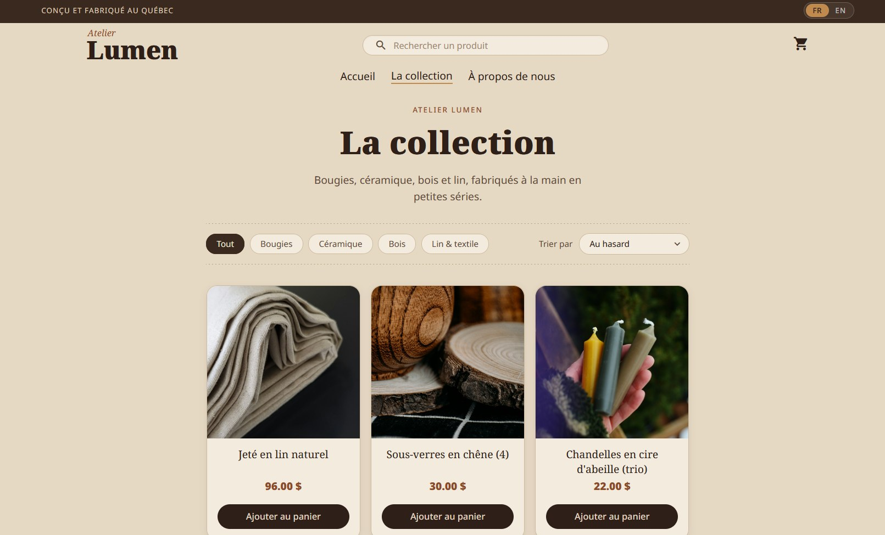

# Atelier Lumen

<h3 align="center"><a href="README.md">Français</a> · <b>English</b></h3>

Personal project to learn PHP and MySQL. It's an online shop for handmade items, with a product catalogue, a search bar and a shopping cart that updates without reloading the page.

**Live site:** [atelier-lumen.infinityfreeapp.com](https://atelier-lumen.infinityfreeapp.com)

## Features

- Product catalogue loaded from a MySQL database
- Category filter, sorting and search without reloading the page
- Shopping cart: add, change quantity, remove and subtotal
- Cart kept between visits (session and cookie)
- Bilingual site, in French and English
- Layout adapted for desktop and mobile

## Technologies

PHP, MySQL, JavaScript (Fetch API), HTML, CSS, XAMPP

## Run locally

Place the folder in XAMPP's `htdocs` folder, start Apache and MySQL, then import `data/atelier_lumen.sql` in phpMyAdmin to create the database. Then open `localhost/atelier-lumen` in the browser.
