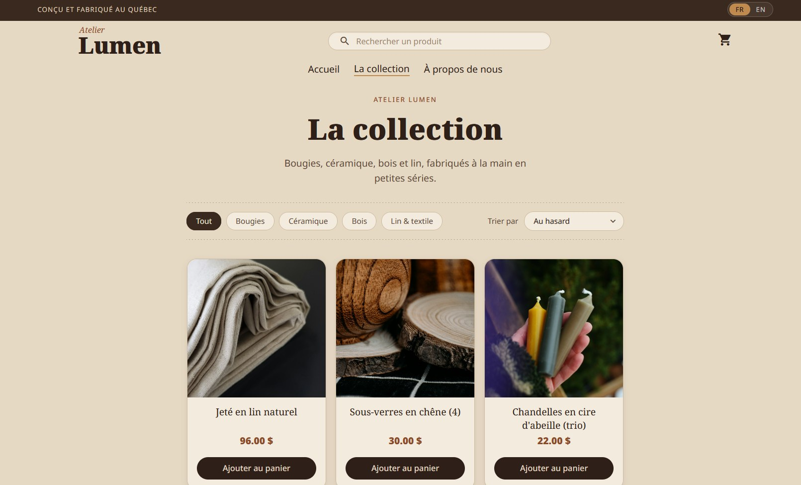

# Atelier Lumen

Projet personnel pour apprendre PHP et MySQL. C'est une boutique en ligne d'objets faits main, avec un catalogue de produits, une recherche et un panier d'achats qui se met à jour sans recharger la page.

## Fonctionnalités

- Catalogue de produits chargé depuis une base de données MySQL
- Filtre par catégorie, tri et recherche sans recharger la page
- Panier d'achats : ajout, changement de quantité, suppression et sous-total
- Panier conservé entre les visites (session et cookie)
- Site bilingue, en français et en anglais
- Mise en page adaptée à l'ordinateur et au mobile

## Technologies

PHP, MySQL, JavaScript (Fetch API), HTML, CSS, XAMPP

## Lancer en local

Placer le dossier dans le dossier `htdocs` de XAMPP, démarrer Apache et MySQL, puis importer `data/atelier_lumen.sql` dans phpMyAdmin pour créer la base de données. Il suffit ensuite d'ouvrir `localhost/atelier-lumen` dans le navigateur.
